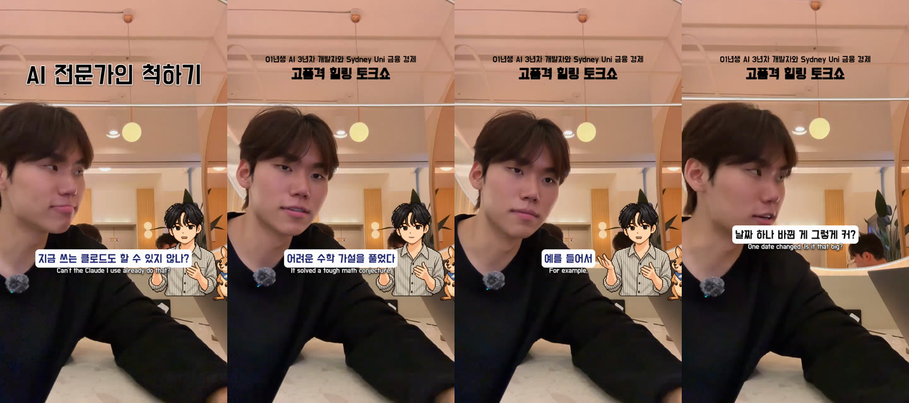
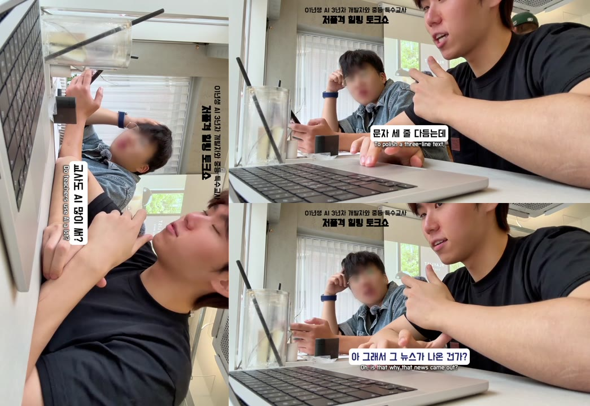

# claude-reels-edit 🎬

[](LICENSE)

English | [한국어](README.ko.md)

**Claude skills that cut and caption a two-person talk Reel** — you shoot the footage and do the
2-minute look pass in CapCut; Claude does the slow part (cutting, then Korean + English captions),
shows you a preview at each step, has an independent QA agent check the result, and renders the 4K master.

> This is the exact workflow I use for my Instagram channel [@geono_x](https://www.instagram.com/geono_x/)
> (economy and AI explained as a conversation between me and my friend 정우), released as-is.
> It is tuned to my format and my house style; the [journey](docs/JOURNEY.md) explains every rule so you can
> retune it for yours.





---

## Why this exists

When I edited in CapCut, the time went to two things: **cuts ≫ captions ≫ everything else**.

The first version tried to do everything, including the look. After five rounds of feedback the face retouch
still looked off (the slimming warp bent my jaw, then tore at my neck) and the voice chain made us louder but
noticeably processed. Meanwhile CapCut did voice, face, colour and sharpness in about two minutes and looked better
([the full story](docs/JOURNEY.md#2-what-went-wrong--my-feedback-on-v1)). So the skill uses AI **only at the
bottleneck** and leaves the quality-sensitive look to CapCut:

| Step | Who | Why |
|---|---|---|
| Look pass (voice, face, colour, sharpness) | **You, in CapCut** (~2 min) | CapCut's tools beat a rebuilt pipeline; the source is never re-graded |
| ① Cut | **Claude** → preview → your OK | the longest manual step |
| ② Korean captions → English captions translated from them | **Claude** → preview → your OK | the second-longest step; EN from the final KR stays in sync |
| ③ Retention extras (zoom punch-in, guest character, header, cards) | Claude, optional | only rules backed by research and my feedback |
| ④ QA | **an independent subagent** | re-listens to and re-watches the output; doesn't trust the plan |
| ⑤ 4K master | your Mac | source resolution, overlays on top |

## Proof so far

| Episode | What | Result |
|---|---|---|
| **ep9 「트럼프 전쟁」** — [my own CapCut edit](https://www.instagram.com/reel/DeIZ4g9J8vI/) | ground truth: segments, speeds, caption styles and character timing read from the CapCut draft JSON | style spec + an automatic evaluator (`eval/gt9.json`, `eval/evaluate.py`) |
| **ep10 「GPT-6」** — same set-up and framing, different content | 283.5 s take → **97.3 s**, 34 segments, 58 KR+EN captions, cold-open hook | QA round 1: 1 blocker / 3 major / 11 minor → round 2: 0 blocker ([findings](examples/ep10/qa_round1_findings.json)) |
| **ep11 「AI 빈부격차」** — a different framing: landscape two-shot, guest on camera (a middle-school special-ed teacher friend, not 정우) | 219.5 s take → **94.1 s**, 25 segments, 56 KR+EN captions; uploaded as a landscape edit turned 90° clockwise (the viewer tilts the phone); a face mosaic was tried and dropped (it shimmered on movement) | QA round 1: 0 blocker / 2 major / 12 minor → all majors fixed ([case 2](docs/JOURNEY.md#7-case-2--a-different-framing-ep11)) |
| **ep12 「대체 안 되는 AX 인재」** — a conference recap: 5 audience-view clips, no conversation take, planning first (4 planner subagents + a judge) | hand-built EDL over 2 concatenated clips, speaker lines + reveal panels, ~49 s; 9 preview rounds of feedback → overlay pacing rule | [feedback log](examples/ep12/feedback.md) |
| more framings | next: two cameras, standing / walking shots | planned |

---

## What's inside

| Path | What it is |
|---|---|
| [`skills/reels-talk-edit/`](skills/reels-talk-edit/SKILL.md) | The main skill: a staged workflow (intake → cut → subs → enhance → QA → 4K) that one agent follows in order |
| [`skills/reels-qa/`](skills/reels-qa/SKILL.md) | The QA skill, run by a fresh subagent that never sees the editing plan |
| `skills/reels-talk-edit/scripts/` | Deterministic tools Claude calls: STT + word alignment, diarization, face track, EDL builder, renderer, cut list, auto QA |
| `skills/reels-talk-edit/references/` | Loaded on demand: one file per format (portrait off-camera / landscape two-shot), retouch-from-raw, plan keys, the style spec measured from my edit, retention research |
| `skills/reels-talk-edit/eval/` | ep9 ground truth + evaluator (regression test) |
| [`examples/ep10/`](examples/ep10) | A real `plan.json` (every editorial decision + KR/EN captions), the cut list and the QA report |
| [`docs/JOURNEY.md`](docs/JOURNEY.md) | Why it is built this way and how it got here (tournament, feedback, redesign) |

Division of labour: **Claude makes every editorial decision in `plan.json`** (what to drop, where lines end,
caption text, English, hook); the scripts only do mechanics (alignment, timing, rendering, measuring). That keeps
the output reproducible and every fix a one-line plan edit.

---

## 🚀 Install with Claude

```bash
git clone https://github.com/mingeonho1/claude-reels-edit.git ~/claude-reels-edit && cd ~/claude-reels-edit && claude "Read INSTALL.md and install the reels skills"
```

Or in Claude (Cowork / claude.ai) — add `skills/reels-talk-edit` and `skills/reels-qa` as skills (zip each folder,
or ask Claude to propose them as skills from this repo), then run `scripts/fetch_assets.sh` once in the session.

## 🛠 Install manually

```bash
git clone https://github.com/mingeonho1/claude-reels-edit.git ~/claude-reels-edit
cd ~/claude-reels-edit
pip install -r requirements.txt            # numpy, opencv-python, pillow, scipy, sherpa-onnx, soundfile
bash skills/reels-talk-edit/scripts/fetch_assets.sh   # fonts, YuNet, speech models (~1.4 GB) → ~/reels_models
mkdir -p ~/.claude/skills && cp -R skills/reels-talk-edit skills/reels-qa ~/.claude/skills/
```

Requirements: Python 3.10+, ffmpeg ≥ 4.4 with libx265, ~2 GB disk for models. A guest character GIF is not
included — put your own transparent GIF at `skills/reels-talk-edit/assets/character.gif` or switch the module off.

---

## 🧩 Skill design (why one skill + references)

Checked against [Claude's skill authoring best practices](https://platform.claude.com/docs/en/agents-and-tools/agent-skills/best-practices),
[Claude Code skills](https://code.claude.com/docs/en/skills) and [Codex skills](https://developers.openai.com/codex/skills):

| Guidance | What this repo does |
|---|---|
| Codex: "keep each skill focused on one job" | `reels-talk-edit` = one job (footage → finished reel). `reels-qa` = a different job (review a finished reel) |
| Claude: SKILL.md under 500 lines, details in files loaded only when needed, one level deep, organised by variant | SKILL.md holds only the workflow (~120 lines). Each format is one reference file — `format-portrait-offcam.md`, `format-landscape-twoshot.md` — and Claude reads exactly one. Retouch-from-raw and the full plan keys are references too |
| Claude: checklists + feedback loops for multi-step work | the 6-stage checklist, two approval gates, QA → fix → re-check until 0 blocker / 0 major |
| Claude: scripts for deterministic work | Claude makes the editorial calls in `plan.json`; scripts do timing, rendering and measuring |
| Claude Code: `context: fork` runs a skill in an isolated subagent | `reels-qa` declares `context: fork`, so it never sees the editing plan |

So a new framing (ep11's landscape two-shot) is a new reference file, not a new skill: the workflow I care about —
cut → approve → Korean → English from the Korean → approve → optional extras → independent QA → 4K — stays in one place.
Both skills use the shared SKILL.md format, so they also run in Codex (`~/.agents/skills/`).

---

## 🧭 Usage

Put the CapCut-corrected export next to the raw take, e.g. `~/capcut/me/10_ai_gpt6/소스/1차_보정.mov`, then:

> 10번 릴스 편집해줘 — 보정본은 소스/1차_보정.mov
> *(Edit reel 10, the corrected file is 소스/1차_보정.mov)*

Claude then:

1. **Intake** — proxy + audio, STT (whisper-turbo + Korean zipformer for word timing), who-speaks-when
   (voice clusters + on-camera mouth motion), a word list it reads end to end.
2. **Cut → gate 1** — `cut_preview.mp4` with a running timecode + `cutlist.md` (kept lines, dropped lines and why).
   Reply "ㅇㅋ" or "37초 컷 어색해"; it maps the timecode back and re-cuts.
3. **Captions → gate 2** — Korean in my house style, then English translated 1:1 from the final Korean.
4. **Enhance** (optional) — hook title over the cold open, header, guest character, host-only punch-ins, cards.
5. **QA** — a fresh subagent runs `qa_auto.py` + a human-style pass; blockers/majors get fixed and re-checked.
6. **4K** — rendered in ≤ 150 s chunks on the Mac (resumable), loudness-verified.

Say "자동 승인" / "auto-approve" to skip the gates (Claude still looks at stills itself).

Key numbers it uses (all explained in the [journey](docs/JOURNEY.md)):

| Rule | Value |
|---|---|
| Speed (pitch kept) | host 1.20 · guest 1.30 · mixed 1.25, cap 1.32 |
| Speaker turn gap | 0.20 s of silence (> 0.5 s reads as dead air) |
| Cut padding | 0.09 s in / 0.12 s out, 12 ms fades, only inside verified quiet |
| Caption | one clause, ≤ 16 chars w/o spaces, ≥ 0.45 s, ≤ 13 chars/s, no emoji |
| Punch-in | 1.08×, hard cut only, only where the host's line starts, ≤ 1 per 8 s |
| Cards | ≤ 1 per 15–20 s, only numbers actually said on tape |
| Loudness | −10.5 LUFS (corrected input), true peak ≤ −1 dBTP |

## 🏗 How it works

```
CapCut-corrected .mov ──► device_proxy.py ──► src_720.mp4 + src.wav
                                   │
  analyze_audio.py (whisper-turbo + zipformer-ko + VAD) ─┐
  diarize.py (ERes2Net + 2-cluster) ─────────────────────┼─► build_words.py ─► words.json / words.txt
  face_track.py (YuNet mouth motion) ────────────────────┘                          │
                                                                Claude writes plan.json (drops, captions, EN, hook…)
                                                                                    ▼
                                    build_edl.py ─► edl.json (segments, speeds, turn gaps, captions, layers)
                                                                                    ▼
                         render.py prepare / run / audio / finish  (chunked, resumable, x265 10-bit)
                                                                                    ▼
                         qa_auto.py + reels-qa subagent ─► qa_findings.json ─► plan fixes ─► 4K master
```

The skill was written for **Claude Cowork** (a cloud sandbox linked to my Mac: STT runs in the cloud, the 4K render
runs next to the source files on the Mac). Paths in `SKILL.md` follow my folder layout
(`~/capcut/me/<NN_topic>/소스/`); with Claude Code on one machine, everything runs locally — just tell Claude
where your files are.

## Optional: rebuilding the look from the raw iPhone file

If you skip CapCut, stage R reproduces most of my CapCut look: a 3D LUT fitted on 25 raw→export frame pairs
(`assets/his_look.cube`, background error 8.8 → 2.75 /255), light skin smoothing, a uniform 3.5 % head shrink and a
voice chain. It reaches roughly 85–90 % of the CapCut result, which is why it is off by default.

## 📄 License · credits

- Code and docs: [MIT](LICENSE). Third-party assets are downloaded by `fetch_assets.sh`, not redistributed — see [NOTICE](NOTICE).
- `examples/` and `eval/gt9.json` contain transcripts of my own published episodes; reuse them for testing only.
- An independent personal project, not affiliated with Anthropic, Instagram or CapCut.
